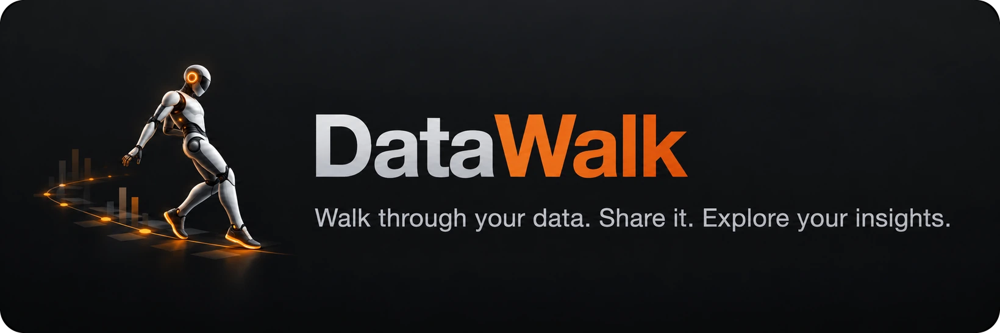
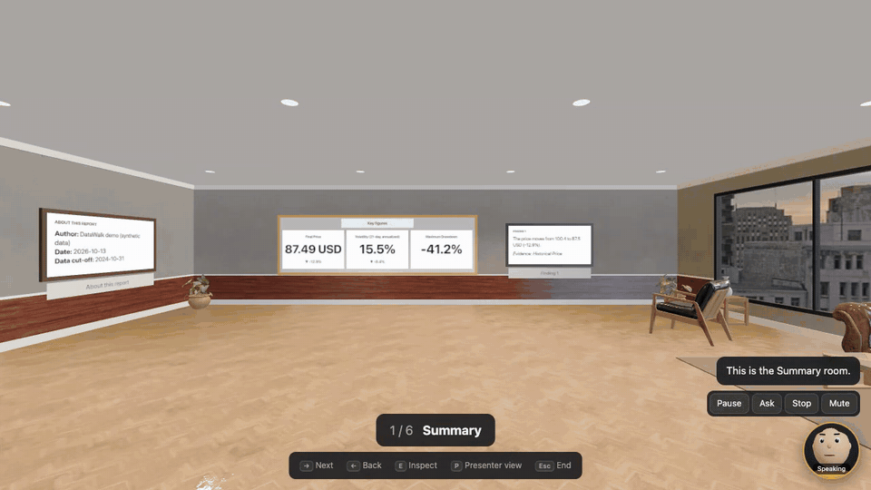

<p align="center">
  
</p>

<p align="center">
  <b>Turn notebooks, charts, and reports into a 3D space that people can walk through.</b><br>
  Each topic is a room. Each chart hangs on a wall. Share it as one file.
</p>

<p align="center">
  <a href="https://github.com/datasound-projects/datawalk/actions/workflows/ci.yml"></a>
  <a href="LICENSE"></a>
  
  
</p>

<p align="center">
  
  <br><sub>Walk with the keyboard and mouse, look closer at a chart, go through a door to the next topic.
  <a href="https://github.com/datasound-projects/datawalk/releases/download/v0.1.0a2/datawalk-demo-4k.mp4">Watch it in 4K</a>.</sub>
</p>

## Install

You need [uv](https://docs.astral.sh/uv/getting-started/installation/) and git. Then one
command installs everything else (macOS, Windows, Linux):

```bash
uv tool install "datawalk[all] @ git+https://github.com/datasound-projects/datawalk"
```

The first install takes a few minutes. Try it with the demo report:

```bash
datawalk demo
```

**For the AI guide** (optional): install [Ollama](https://ollama.com/download), then run:

```bash
ollama pull nemotron-3-nano:4b
uv tool install "datawalk[all,voice] @ git+https://github.com/datasound-projects/datawalk"
datawalk demo --guide
```

This gets the AI model, adds the voice (downloaded on the first start), and starts the demo
with the guide. To use another Ollama model, pull it and name it:
`datawalk demo --model qwen3:14b`.

**Update** (optional) to the latest version:

```bash
uv tool upgrade datawalk
```

## AI-assisted walkthrough

<p align="center">
  
  <br><sub>A real run with the local model on a laptop (Apple M2), from an earlier version. The model's thinking time before the answer is cut.</sub>
</p>

The AI guide presents your report like a person walking you through it. Press **X** (or
click the avatar), choose 3, 5, or 10 minutes, and click **Present**:

- It walks from room to room through the doors and introduces each one: "And now let's take
  a look at *Model Evaluation*: Model Comparison, ROC Curve, and Walk-forward Evaluation."
- It stops in front of each chart, close enough to read it, and explains it aloud with captions.
- Ask anything, any time: "Explain this chart", "Which model performs best?", "When did it
  happen?". It answers with the facts, what they mean, and their limits, and shows the evidence.

**How it stays correct.** Everything runs on your computer. DataWalk computes the facts from
your data and interprets them with expert rules (statistics, machine learning, finance); the
local AI model only puts them into words, and every number is checked against your report.
Without a model, the facts answer directly. On 92 test questions, the default 4B model
passes 91 ([how it is measured](docs/guide.md#how-the-guide-answers)).

Set it up: [Install](#install), "For the AI guide". More: [docs/guide.md](docs/guide.md).

## Use

```bash
datawalk open analysis.ipynb      # a notebook: each ## heading becomes a room
datawalk open report.dwk --edit   # rename, rearrange, choose room styles, set the tour
datawalk export report.dwk        # one HTML file that opens offline in any browser
```

From Python (Matplotlib, Seaborn, Plotly, Altair, Bokeh, pandas, images, PDF pages):

```python
import datawalk as dw

report = dw.Report("Quarterly Review")
report.add(sales_chart, key="sales", room="Sales")
report.show()  # opens the report in your browser
```

**In the room:** W A S D and the mouse walk, **E** looks closer at a chart, **Tab** lists the
rooms, **M** shows a map, **Page Down** starts the guided tour, **X** opens the AI guide.

## Room styles

| Executive Office | Home Office | Light Gallery | Dark Gallery | Industrial Loft |
|---|---|---|---|---|
|  |  |  |  |  |
| **Minimalist Studio** | **Museum Atrium** | **Futuristic Lab** | **Metaverse Pavilion** | **Data Command Center** |
|  |  |  |  |  |

## Share

One HTML file (opens offline, nothing to install), a web folder, PDF, PowerPoint, or a video
of the tour. Every export first shows what data leaves your computer. For teams, an optional
hub adds sign-in, comments, and live presenting.

## Learn more

[Sources](docs/sources.md) · [Presenting](docs/presenting.md) · [AI guide](docs/guide.md) ·
[Exports](docs/exports.md) · [Team hub](docs/hub.md) · [Install options](docs/install.md) ·
[Contributing](CONTRIBUTING.md) · [Security](SECURITY.md) · [Changelog](CHANGELOG.md)

Status: alpha, tested on every change ([known limits](docs/production-readiness.md)). MIT
license. Room assets: CC0 from [Poly Haven](https://polyhaven.com) ([credits](docs/credits.md)).
