<p align="center">
  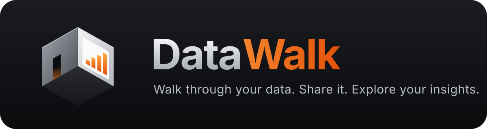
</p>

<p align="center">
  <b>Turn notebooks, charts, and reports into a 3D space that people can walk through.</b><br>
  Each topic is a room. Each chart hangs on a wall. Walk in, look closer, and share it as one file.
</p>

<p align="center">
  <a href="https://github.com/datasound-projects/datawalk/actions/workflows/ci.yml"></a>
  <a href="LICENSE"></a>
  
  
</p>

<p align="center">
  
  <br><sub>The demo report below: walk with the keyboard and mouse, look closer at a chart, go through a door to the next topic.
  <a href="https://github.com/datasound-projects/datawalk/releases/download/v0.1.0a2/datawalk-demo-4k.mp4">Watch it in 4K</a>.</sub>
</p>

## Why DataWalk

- **Presentations people remember.** A report becomes a place: one room per topic, charts on the walls.
- **No new work.** Use the notebook or charts you already have. One command.
- **Easy to share.** Send one HTML file. It opens in any browser, offline, with nothing to install.
- **Private by default.** No cloud, no AI service. You see what leaves your computer before you share.

## Install

You need Python 3.11 or later. Install DataWalk as a command (works on macOS, Windows, and Linux):

```bash
uv tool install "datawalk[all] @ https://github.com/datasound-projects/datawalk/releases/download/v0.1.0a2/datawalk-0.1.0a2-py3-none-any.whl"
```

No `uv`? Use `pipx install` with the same text in quotes. To use DataWalk from your own Python
code or notebooks, install it in a virtual environment:

```bash
python3 -m venv .venv && source .venv/bin/activate
pip install "datawalk[all] @ https://github.com/datasound-projects/datawalk/releases/download/v0.1.0a2/datawalk-0.1.0a2-py3-none-any.whl"
```

On Windows, activate with `.venv\Scripts\activate` instead.

Check it with a ready-made demo:

```bash
datawalk demo
```

## Turn your work into rooms

| You have | Do this |
|---|---|
| A Jupyter notebook | `datawalk open analysis.ipynb` |
| Charts in Python (Matplotlib, Seaborn, Plotly, Altair, Bokeh) | `report.add(fig, key="sales", room="Overview")` |
| Tables (pandas, CSV, Excel) | `report.add(df, key="table", room="Overview")` or `report.add("data.xlsx", ...)` |
| A PDF report (for example from Power BI or Tableau) | `report.add_pdf("report.pdf", room="BI")` |
| Images (PNG, JPG, SVG) | `report.add("chart.png", key="chart", room="Overview")` |
| Text and key numbers | `report.add_text(...)`, `report.add_kpi(...)` |
| Plotly or Vega-Lite JSON, Markdown, MLflow runs | See [docs/sources.md](docs/sources.md) |

**A notebook is one command.** Each `##` heading becomes a room, and each chart becomes a
display. Run the notebook and save it first (or add `--execute`).

**From Python:**

```python
import datawalk as dw

report = dw.Report("Quarterly Review", theme="executive_office")
report.add(sales_chart, key="sales", room="Sales")
report.add(costs_table, key="costs", room="Finance")
report.show()  # opens the editor in your browser
```

## In 30 seconds

1. **Open:** `datawalk open analysis.ipynb --edit`
2. **Walk:** click **Enter room**. Move with **W A S D**, look with the **mouse**.
3. **Look closer:** aim at a chart and press **E**: zoom, hover, and see the exact values.
4. **Change topic:** walk through a door, or press **Tab** to jump to any room. **M** shows a map.
5. **Make it yours:** click **Edit report** to rename charts, move them between rooms, group
   them into dashboards, choose a room style, and set the order of a guided tour.
6. **Share:** in the editor, **Export** makes one HTML file. Send it like any attachment.

Present with a clicker: **Page Down** starts the guided tour. Phones and tablets open a
simple page view of the same report.

## Room styles

Choose a style for the whole report or for each room (editor, **Themes** tab).

| Room | Style | Feels like |
|---|---|---|
| 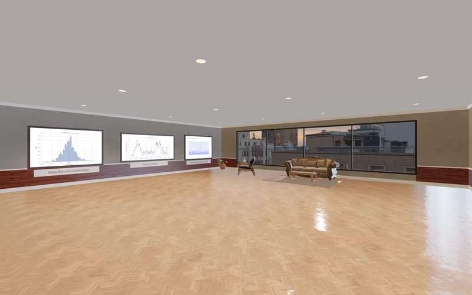 | **Executive Office** | Wood, leather, city views: board-level reviews |
| 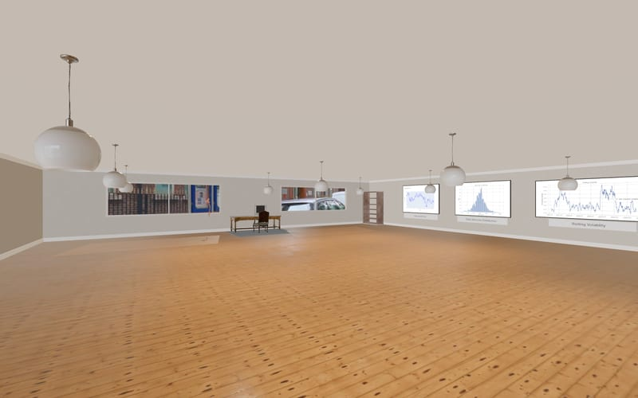 | **Home Office** | Warm and informal, with shelves and daylight |
| 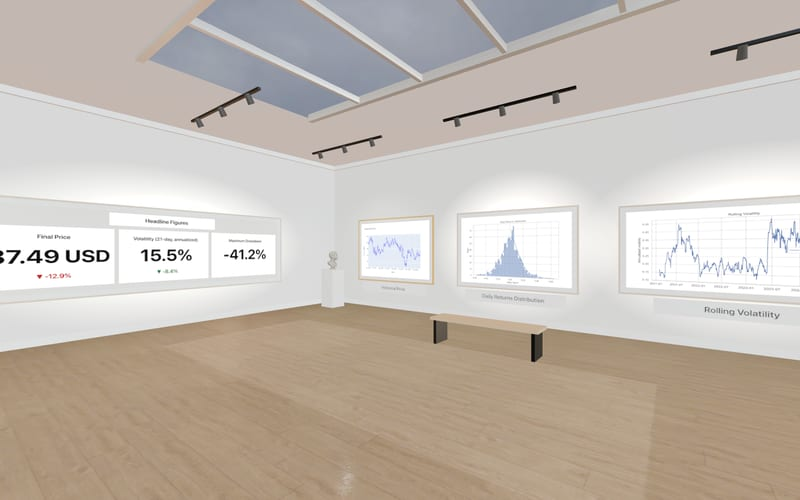 | **Light Gallery** | White walls and daylight: the charts come first |
| 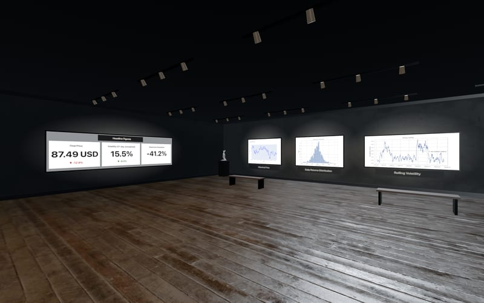 | **Dark Gallery** | Dark walls and spotlights: high contrast |
| 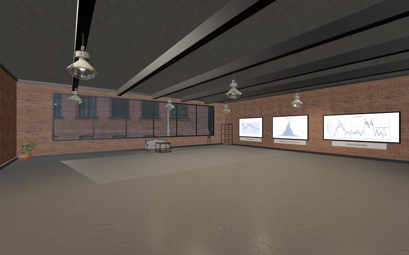 | **Industrial Loft** | Brick, steel, and tall windows |
| 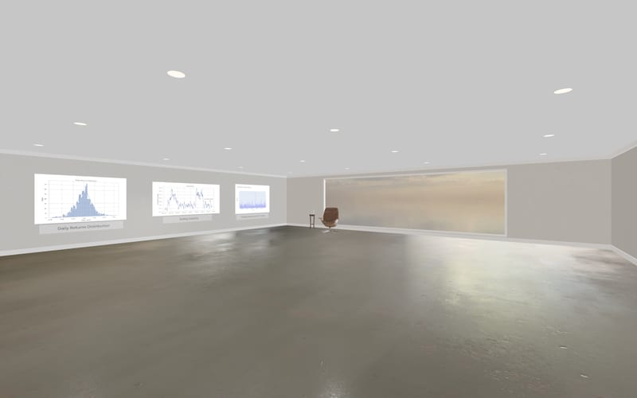 | **Minimalist Studio** | Plain and calm, nothing distracts |
| 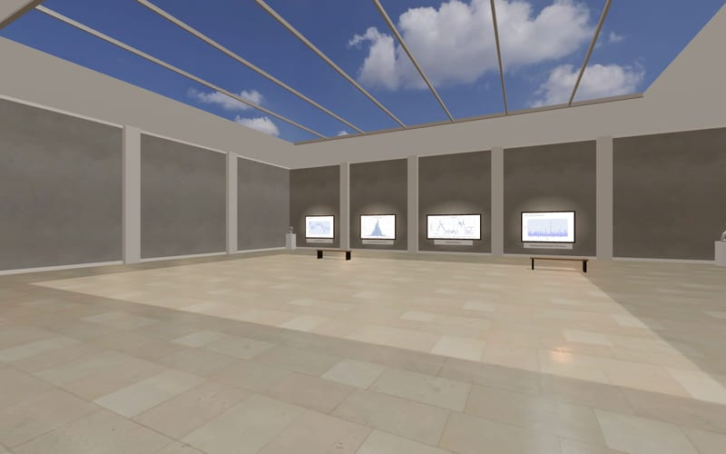 | **Museum Atrium** | Tall space with skylights and plinths |
| 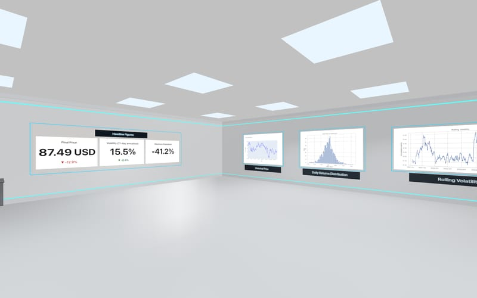 | **Futuristic Lab** | Clean lab surfaces and light strips |
| 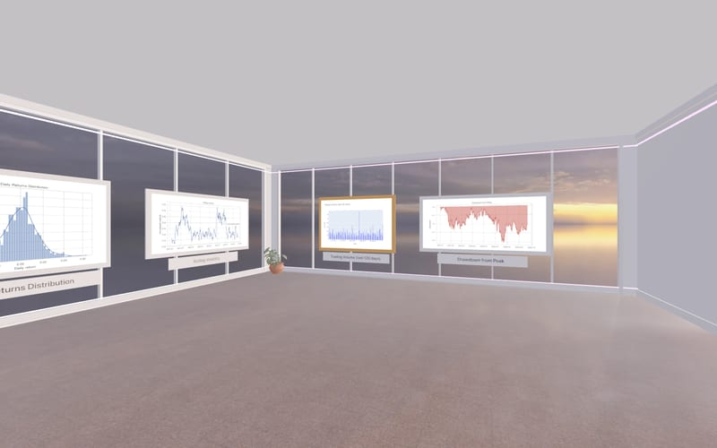 | **Metaverse Pavilion** | An open glass pavilion under the sky |
| 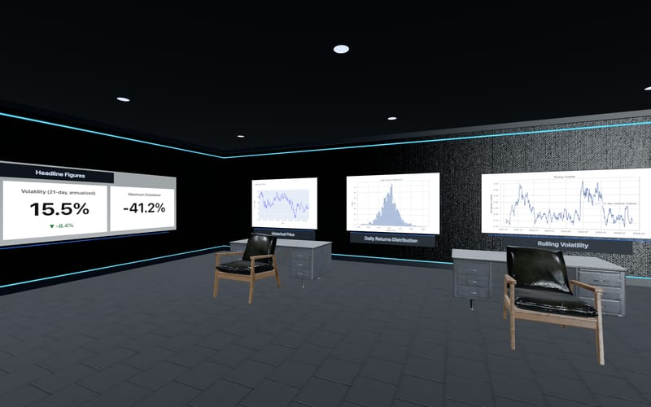 | **Data Command Center** | A dark control room with large screens |

## Demos

**Thematic market sectors** (the GIF above): a research notebook with public data about AI,
water, robotics, and quantum computing. One room per sector.

```bash
curl -LO https://raw.githubusercontent.com/datasound-projects/datawalk/main/examples/thematic_sectors/thematic_sectors.ipynb
datawalk open thematic_sectors.ipynb --edit
```

**Financial research** (synthetic data, 25 charts in 4 rooms): `datawalk demo`

## Share it

| Format | For |
|---|---|
| One HTML file | E-mail, Teams, SharePoint: opens offline in any browser |
| Web folder | Any web server or intranet |
| PDF and PowerPoint | Documents and slide decks |
| Video | The guided tour as an MP4 |
| Team hub (optional) | Sign-in, permissions, comments, and live presenting for a team |

`datawalk export report.dwk` makes the HTML file. Every export first shows what data leaves
your computer. Details: [docs/exports.md](docs/exports.md).

## AI guide (optional)

Start with `--guide`, and a small avatar presents the report: it plans a 3, 5, or 10-minute
tour, moves the camera, explains each stop aloud, and answers questions such as "Explain this
chart" or "Show the best model". A local model (Ollama, `nemotron-3-nano:4b`) writes the text;
DataWalk checks every stop and every number against the report. Nothing leaves your computer.

```bash
ollama pull nemotron-3-nano:4b
datawalk demo --guide
```

Voice (Kokoro), facial animation (NVIDIA Audio2Face-3D), and spoken questions are optional.
Details: [docs/guide.md](docs/guide.md).

## Good to know

- **Your edits are safe.** Run your analysis again: names, rooms, and the tour stay.
- **Works offline.** The viewer needs no internet and no account.
- **Status: alpha.** It is tested on every change. Known limits are listed in
  [docs/production-readiness.md](docs/production-readiness.md).

## Learn more

[Sources](docs/sources.md) · [Presenting](docs/presenting.md) · [AI guide](docs/guide.md) · [Exports](docs/exports.md) ·
[Team hub](docs/hub.md) · [Governance](docs/governance.md) · [Install options](docs/install.md) ·
[Contributing](CONTRIBUTING.md) · [Security](SECURITY.md) · [Changelog](CHANGELOG.md)

MIT license. Room assets: CC0 from [Poly Haven](https://polyhaven.com) ([credits](docs/credits.md)).
